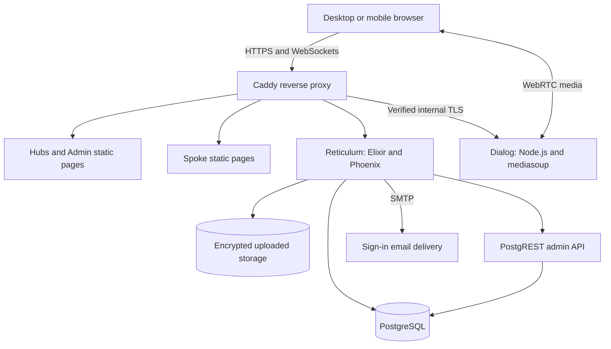

# Molecular Hubs

### An immersive biology classroom for exploring cells and organelles

**Master's dissertation project by Arda Konut — MSc Interactive Media, University College Cork, 2024.**

Molecular Hubs is a browser-based virtual learning environment for exploring plant, bacterial, and human cells. It combines original Blender modelling, a purpose-built classroom, educational media, and the shared-space capabilities of Mozilla Hubs / Hubs Foundation.

The original project investigated how a collaborative 3D environment could support the exploration of cellular biology for second-level education. A later restoration phase recovered the classroom and deployed it on an ARM cloud server.

**[Explore Science Lab](https://molecular-hubs-ardakonut.duckdns.org/YBtXYPs)** · **[Project homepage](https://molecular-hubs-ardakonut.duckdns.org)**

## Try the demonstration

1. Open **Explore Science Lab** in a modern browser. A desktop or laptop is recommended for examining the detailed models.
2. Join as a guest; an account is not required.
3. Allow the scene and its materials to load, then explore the classroom and inspect its cellular structures.
4. If visiting with someone else, test avatar visibility, text chat, and voice communication. Headphones are recommended.

The environment has also been tested between a Windows laptop and an iPhone. Microphone permission is needed to speak, not to view the classroom.

The public demonstration protects the saved classroom from visitor edits. Some pinned PDF and video controls depend on room permissions and remain owner-controlled; a separate guest-only media viewer is not included.

## Academic context

**Dissertation title:**

> Molecular Hubs: An Immersive Web Application for Interaction with Virtual Cells and Organelles for Second-Level Education Cellular Concepts

| Detail | Information |
| --- | --- |
| Author | Arda Konut |
| Year | 2024 |
| Programme | MSc Interactive Media |
| Institution | University College Cork / National University of Ireland, Cork |
| School | School of Computer Science & Information Technology |
| Supervisor | David Murphy |
| Project context | Developed in collaboration with UCC's School of Microbiology and the ELEVATE team |
| Intended audience | Second-level biology learners |

ELEVATE — Enhanced Active LEarning in Virology, cell culture and moleculAr bioTEchnology — proposed the educational concept. The project drew on constructivist and connectivist learning perspectives: learners explore representations, connect resources, and discuss cellular structures with peers or an instructor.

The intended benefit was to supplement conventional diagrams and classroom explanations with spatial exploration. The project does not present its models as microscope reconstructions or claim that browser access alone guarantees better learning.

## My original contribution: the 2024 dissertation project

### 1. Designing the learning environment

I designed and assembled a virtual classroom around plant, bacterial, and human cells, with organelles presented both as parts of larger structures and as individual objects for examination.

The spatial arrangement, labels, PDFs, and instructional videos were selected and integrated to support comparisons between cell types and discussion of their constituent structures. The shared environment allowed learners to view the same material while communicating through Hubs' existing tools.

### 2. Modelling cells and organelles in Blender

I created the featured cellular models using primitive meshes and Blender's modelling tools. The dissertation documents the practical techniques and trade-offs involved, including:

- **Subdivision surfaces** for smoother organic forms, including the human-cell mitochondria.
- **Lattice and Simple Deform modifiers** for controlled bends and deformation, particularly in the plant-cell endoplasmic reticulum.
- **Hair particle systems and metaballs** for organic-looking structures, with attention to the additional geometry and file size they could introduce.
- **Displacement and procedural Cloud textures** for surface variation, including the human-cell peroxisome.
- **Material adjustment for web export**, balancing the appearance in Blender against what GLB/glTF and the browser renderer could reproduce.

One documented rendering problem involved chloroplast materials that looked correct in Blender but exported poorly. Replacing unsupported material arrangements with a Principled BSDF-based setup improved their appearance in the web environment.

Editable projects are retained in [Blender_Files](hubs-compose/Blender_Files), alongside exported classroom, cell, organelle, and label assets in [3D_Models](hubs-compose/3D_Models).

### 3. Integrating and troubleshooting the Hubs platform

I worked through two local deployment approaches:

1. A manual setup of Hubs, Spoke, Reticulum, Dialog, and PostgreSQL using WSL-based terminals and the required Node.js, Elixir, and Erlang toolchains.
2. A Docker-based workflow using Hubs Compose and Mutagen after encountering unresolved integration problems with the manual setup.

The dissertation records work on service configuration, certificates, JWT/JWK configuration, browser/backend communication, and Windows/Unix line-ending compatibility. It also discusses the distinction between Spoke's scene descriptions, runtime A-Frame entities, and persistent application data.

The result was an educational application built by adapting and integrating an existing platform. The underlying Hubs rendering, avatar, networking, and media systems were not written from scratch for this dissertation.

### 4. Evaluating the prototype and documenting its limitations

I evaluated the prototype through a Google Forms survey with **10 participants**. It combined a **nine-item usability questionnaire adapted from the System Usability Scale**, six e-learning questions, and written feedback.

The participants had technology-related familiarity; this was not a classroom trial with the intended second-level biology audience.

Selected results, combining positive response categories from the dissertation's tables:

| Reported perception | Positive responses |
| --- | --- |
| The system was easy to use | 80% — Table 8.2 |
| The virtual lab could reinforce existing knowledge of cells and organelles | 80% — Table 8.4 |
| The 3D models helped users understand individual characteristics | 80% — Table 8.4 |
| Information was clear and easy to understand | 90% — Table 8.4 |
| PDF/video materials were useful | 50% — Table 8.4 |

Participants valued the models and communication features. Their feedback also identified unclear navigation and flying-mode instructions, limited interaction with organelles, and difficulties managing media playback.

These findings describe **self-reported usability and perceived educational value**. They do not demonstrate improved attainment or long-term retention, and the adapted questionnaire is not reported here as a standard ten-item SUS score.

## Implemented features and original project boundaries

| Area | What the project provides |
| --- | --- |
| Biology environment | A classroom with plant, bacterial, and human-cell representations, organelles, and identifying labels. |
| Educational resources | PDF and video materials positioned within the room. |
| Shared exploration | Hubs avatars, voice communication, and text chat around the same scene. |
| Scene authoring | Spoke-based composition and imported Blender/GLB assets. |
| Persistent materials | Saved room objects and placement, subject to ownership and permissions. |

The dissertation's proposed **organelle assembly exercises, interactive quizzes, and gamification features were not completed**. They remain potential future directions, rather than implemented features.

## Later restoration and deployment: a separate phase

In 2026, the project was revisited to recover the completed classroom and make it accessible beyond its original local-machine setup.

**This later phase used AI assistance for code changes, deployment scripts, and troubleshooting, with Arda Konut carrying out configuration, testing, and verification. It is separate from the original dissertation contribution.**

The work included:

- Repairing local startup, HTTPS configuration, dependency setup, and service coordination.
- Recovering the populated classroom from PostgreSQL and uploaded-file storage backups.
- Moving the application to an Ubuntu ARM64 OCI Ampere instance.
- Building native ARM backend images and cross-building frontend assets on an AMD64 host.
- Configuring Caddy HTTPS routing, Gmail sign-in delivery, and WebRTC media access.
- Recovering the original room owner's account mapping and permissions.
- Adding deployment checks and reusable build helpers in [deploy/oci](deploy/oci).

A later **AI-assisted numeric placement panel** adds world-position, rotation, and proportional-size inputs for shared media. It respects ownership and pinning rules and is not presented as part of the 2024 dissertation implementation. See [ObjectTransformControls.js](hubs-compose/services/hubs/src/react-components/room/ObjectTransformControls.js).

### Why recovery required more than copying files

The application secret participates in uploaded-file encryption, encrypted pinned-object records, and email-based account lookup. Changing it without migrating the corresponding state initially made those resources unusable.

Recovery therefore included re-encrypting uploaded files into a separate storage volume, preserving file identifiers, replacing embedded local file URLs, updating changed file lengths, migrating pinned-object records, and restoring sign-in access to the original owner account. Original backups were retained throughout the process.

## Architecture



| Layer | Technologies and responsibilities |
| --- | --- |
| 3D content | Blender, GLB/glTF, scene composition and educational asset preparation. |
| Browser client | JavaScript, React, A-Frame, Three.js, and WebGL; inherited WebXR support for compatible devices. |
| Scene editor | Spoke. |
| Application backend | Elixir/Phoenix Reticulum, rooms, accounts, configuration, and stored objects. |
| Real-time media | Dialog, WebRTC, mediasoup, and protoo signaling. |
| Data | PostgreSQL, PostgREST, and encrypted file storage. |
| Deployment | Docker, Compose, Buildx, Nginx, Caddy, and Ubuntu ARM64 on OCI. |

Database, backend, and administrative API ports are not directly published to the internet. HTTPS/WebSockets enter through Caddy; WebRTC media uses its configured UDP/TCP port range.

## Repository structure

```text
.
├── README.md
├── deploy/oci/
│   ├── bin/                  # Deployment checks and image-build helpers
│   ├── compose*.yaml         # Production service definitions
│   ├── config/               # Public proxy and static-server configuration
│   └── docker/               # Backend builder/runtime Dockerfiles
└── hubs-compose/
    ├── 3D_Models/            # Exported cells, organelles, labels, and classroom
    ├── Blender_Files/        # Editable Blender projects
    ├── Videos.zip            # Archived project media
    ├── LOCAL_DEVELOPMENT.md  # Local setup guidance
    ├── READ_ME.txt           # Historical setup notes
    └── services/
        ├── hubs/            # Browser client and Admin
        ├── spoke/           # Scene editor
        ├── reticulum/       # Application backend
        └── dialog/          # Real-time media service
```

Large model and Blender files use **Git LFS**. Historical filenames and directory spellings are retained.

## Running and developing the project

### Retrieve the source and assets

```bash
GIT_LFS_SKIP_SMUDGE=1 git clone \
  https://github.com/ArdaKonut/Molecular-Hubs-Virtual-Learning-Environment.git
cd Molecular-Hubs-Virtual-Learning-Environment
git lfs install --local
git lfs pull
```

Start with [LOCAL_DEVELOPMENT.md](hubs-compose/LOCAL_DEVELOPMENT.md) for local prerequisites, hostnames, certificate trust, and startup guidance. The customized service source is included: do not clone replacement upstream repositories over it.

The older [READ_ME.txt](hubs-compose/READ_ME.txt) is retained as a dissertation-era record. Its campus-only hosting statements describe the original deployment, and its certificate-bypass advice is superseded by the current trust-based setup.

**Cloning the repository does not recreate the populated hosted room.** Its complete state also requires the application database, uploaded storage, and compatible private configuration. Those private backups and keys are not published here.

### Check an existing production deployment

The production helper adopts an already configured runtime directory and existing volumes. It does not initialize a complete new installation or generate replacement encryption secrets.

```bash
sudo python3 deploy/oci/bin/compose \
  --runtime "$HOME/molecular-hubs-production" check

sudo python3 deploy/oci/bin/compose \
  --runtime "$HOME/molecular-hubs-production" status
```

Public Caddy/Nginx configuration is mounted from the checkout. Credentials, signing keys, SMTP settings, private certificates, and Reticulum configuration stay outside Git in the runtime directory.

### Review image-build commands

On the ARM Ubuntu host:

```bash
bash deploy/oci/bin/build-backend reticulum --dry-run
bash deploy/oci/bin/build-backend dialog --dry-run
```

On the AMD64 Docker host, using Git Bash on Windows:

```bash
bash deploy/oci/bin/build-frontend \
  hubs molecular-hubs-builder "$HOME/hubs-static-arm64-new.tar" --dry-run

bash deploy/oci/bin/build-frontend \
  spoke molecular-hubs-builder "$HOME/spoke-static-arm64-new.tar" --dry-run
```

Omit `--dry-run` only for an intentional build. The frontend helper uses an existing local `docker-container` builder and exports an ARM image archive. It refuses existing destination files and keeps incomplete output separate.

The AMD64 compilation step works around a legacy PhantomJS dependency; the final frontend server images are ARM64. Other compatibility fixes include a compatible Hex pin, Spoke's working directory, dependency-download retries, and an official archive for the same pinned Three.js commit.

## Technical verification

The later deployment was checked through actual use, not just successful image creation:

| Check | Result |
| --- | --- |
| Guest entry | Science Lab loaded without signing in, including an Incognito-browser check. |
| Classroom and persistence | Models and pinned materials loaded and retained their positions after reopening. |
| Owner media controls | PDF navigation and video controls worked after account recovery. |
| Two-device communication | Laptop/iPhone voice worked in both directions; avatar movement and text chat were verified. |
| Authentication | Actual email-link sign-in worked after SMTP configuration. |
| Storage migration | 126 owned files verified, 347 embedded file URLs rewritten, and four pinned-object records migrated. |
| Backup recovery | A network-isolated PostgreSQL restore succeeded: 19 rooms, 126 owned files, four pinned objects, and two accounts at that checkpoint. |
| Build workflow | Helper syntax and dry runs passed. A Reticulum rebuild using the committed backend helper also completed. Fresh Dialog/frontend builds using the new helpers have not been recorded. |

A large scene-file transfer also completed with all 108,732,744 bytes received after backend timeout adjustments. Loading times remain dependent on network speed, device capability, and browser cache; this is not a universal performance benchmark.

## Limitations and future work

- **Learning evaluation:** the original study was small and exploratory. Evaluation with the intended school-age audience and objective learning measures would be needed for stronger educational conclusions.
- **Interaction design:** organelle assembly, quizzes, learner feedback, and gamification remain future work.
- **Guest media controls:** the current permission model limits some pinned PDF/video interactions for visitors.
- **Onboarding:** clearer movement instructions and more obvious interaction cues remain priorities identified in the original study.
- **Content delivery:** the classroom contains substantial 3D assets; broad mobile performance and restrictive corporate-network WebRTC access have not been established.
- **Maintenance:** the platform retains legacy dependencies. A working demonstration is not a complete security modernization of the upstream stack.
- **Reproducibility:** restoring the completed room requires data and compatible secrets in addition to source code.

The current hosted demonstration and the original dissertation prototype are different stages of the same project. Improvements made during restoration should not be read back into the results of the 2024 evaluation.

## Acknowledgements and licensing

The educational concept and subject context were developed with the **ELEVATE team and UCC School of Microbiology**. Academic supervision was provided by **David Murphy**.

The application builds on Mozilla Hubs / Hubs Foundation, Spoke, Reticulum, Dialog, and their supporting open-source projects. Their rendering, networking, avatar, scene-editing, and existing communication/media systems remain upstream contributions.

The repository retains upstream license files, including [hubs-compose/LICENSE](hubs-compose/LICENSE) and the licenses within individual services. Models, textures, PDFs, and videos must also be considered under their respective asset permissions and credits; a software license does not automatically license every educational resource.

**Dissertation reference:** Konut, A. (2024). *Molecular Hubs: An Immersive Web Application for Interaction with Virtual Cells and Organelles for Second-Level Education Cellular Concepts*. MSc Interactive Media dissertation, University College Cork.

**Author:** [Arda Konut](https://github.com/ArdaKonut)
